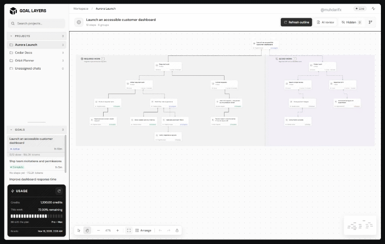

<p align="center">
  
</p>

# Goal Layers

**A clearer view of your goals. A closer look at the evidence.**

🗂️ **Organize goals** · 🌿 **Explore the work tree** · 🔎 **Review scope drift** · 📊 **Trace token usage**

Goal Layers is a local, Rust-based companion for Codex. It turns saved goals, chat activity, and source-linked reports into an interactive work tree, with separate views of required work and additions that need review.

> 🧭 **Evidence first.** Goal Layers helps you inspect the record. Reported completion, verification evidence, and possible scope drift remain distinct—it does not independently certify the work.

## 🌳 See the work tree

Follow a goal through its required work, added work, and recorded step status. This short preview uses fictional project data.



## Find your way

| Start here | Explore the app | Go deeper |
| --- | --- | --- |
| [✨ Features](#features) | [🖱️ Workspace](#using-the-workspace) | [⚙️ Configuration](#configuration) |
| [🚀 Getting started](#getting-started) | [🔎 Progress and drift](#understanding-progress-and-drift) | [🔌 Reporting and API](#agent-reporting-and-api) |
| [🔒 Data and privacy](#data-and-privacy) | [🧠 Local and AI review](#local-extraction-and-ai-review) | [🛠️ Development](#development) |
| [🩺 Troubleshooting](#troubleshooting) | [📌 Limitations and licensing](#limitations-and-licensing) | |

<a id="features"></a>

## ✨ Features

- **Project and goal discovery.** Browse saved Codex goals, including goals created partway through a chat and archived goals available in local stores. Goals sort by their own latest activity.
- **Interactive work tree.** Explore the original goal, work areas, and recorded steps with direct connections, without opening one group at a time.
- **Evidence beside the work.** Inspect source quotations, reported progress, blockers, and the next recorded action in a tabbed details dialog.
- **Scope review.** Keep identifiable human requests with required work. Review other additions without treating every new file or AI action as drift.
- **Token traces.** See recorded source-turn usage where it can be linked to a step. Shared tokens are not presented as an exclusive per-node cost.
- **Local editing and reversible hiding.** Edit existing steps or hide distracting nodes without deleting source files or chat history.
- **Optional AI review.** Ask Codex to review a bounded outline and its selected evidence, with local validation before changes are saved.

<a id="getting-started"></a>

## 🚀 Getting started

### Requirements

- Windows is the primary desktop workflow. Other operating systems have not been validated as a complete desktop experience.
- An installed, signed-in Codex environment with the app-server interfaces used by this project.
- A current Rust toolchain and native platform build tools when building from source.
- A modern web browser.

Codex interfaces and local schemas can change between versions. Compatibility with every Codex release is not guaranteed.

### From source to your first goal

From the project directory:

```powershell
cargo build --release --locked
.\target\release\goal-layers.exe
```

Launching the executable on Windows opens the browser automatically at:

```text
http://127.0.0.1:4317
```

Keep the process running while using the app. To start without opening a browser:

```powershell
.\target\release\goal-layers.exe --no-open
```

A second launch recognizes an existing Goal Layers instance on the expected port and opens it. The executable embeds the web interface and reconstruction schema; they do not need to be distributed as separate files beside the built executable.

The default `data/` directory is created beside the executable, not necessarily in the current terminal directory. Run from a writable location or configure a separate data file.

<a id="using-the-workspace"></a>

## 🖱️ Using the workspace

### Find and inspect a goal

1. Select a project in the sidebar.
2. The first available goal opens automatically; choose another goal to change the canvas.
3. Refresh the local outline to extract updated history.
4. Open a node to inspect its overview, evidence, and connections.

Project matching uses explicit assignments and normalized project/worktree paths. A chat without a reliable project link stays unassigned rather than receiving a guessed assignment. The Projects and Goals sections can be collapsed and resized; these preferences are saved in the browser.

### Canvas controls

| Control | Behavior |
| --- | --- |
| Hand | Default mode. Drag to pan; click a node to open details. |
| Pointer | Move nodes or drag empty canvas space to select multiple nodes. |
| Shift-click | Add or remove individual nodes from a selection. |
| Zoom | Change the canvas scale. Mouse scrolling moves through the canvas. |
| Arrange | Reapply the layout while preserving the camera position. |
| Undo / redo | Step through layout changes in the current session. |
| Lock | Prevent canvas movement and node dragging. |
| Fullscreen | Enter or exit a larger canvas view. |
| Minimap | View the graph's extent and fit the flow. |

Manually moved positions are stored per goal in the browser. Moving or arranging nodes does not rewrite source relationships.

### Details, edits, and hidden nodes

Details use **Overview**, **Evidence**, and **Connections** tabs where applicable. Previous/next controls navigate between nodes. Escape, the close icon, or a click outside dismisses the dialog.

Existing steps can be edited locally. There is no manual Add Step workflow. Marking a local step complete requires evidence text; entering text does not independently verify its truth.

**Hide** asks for confirmation and removes selected nodes and their displayed connections from the view. Source records, history, and overall goal progress remain intact. Children are not automatically hidden. Use **Hidden nodes** to restore individual items. The original goal and display-only groups cannot be bulk-hidden.

<a id="understanding-progress-and-drift"></a>

## 🔎 Understanding progress and drift

| Signal | Meaning | What it does not establish |
| --- | --- | --- |
| Codex goal status | The status recorded for the goal in Codex. | That every step passed its acceptance checks. |
| Reported step status | A status imported from history or a report, or edited locally. | Independent completion or correctness. |
| Verification evidence | A recorded result matched to the step's acceptance check. | Coverage beyond that check, or validity after later changes. |
| Unknown / needs review | Evidence does not support a stronger conclusion. | That no work happened or that it was necessarily wrong. |
| Reported drift | Evidence identifies work outside the recorded request. | A complete account of the AI's reasoning or intent. |

A later relevant failure or edit can invalidate earlier verification evidence. A passing command supports only what it tested. Goal status and step evidence are separate so a chat summary is not automatically treated as proof.

**Required work** includes original scope and identifiable human-requested changes. Human origin is labeled when known. **Added work** contains additions and review candidates, including reported drift. A changed directory, new prerequisite, or AI authorship alone is not proof of drift.

Token traces can connect a node to its first recorded occurrence, surrounding human request, and deduplicated source-turn usage. Several nodes can share a turn; do not add these totals as exclusive per-node consumption. Missing usage remains unavailable. Trace totals may differ from Codex goal accounting, including because of cached input. No dollar cost is calculated.

<a id="local-extraction-and-ai-review"></a>

## 🧠 Local extraction and AI review

### Local outline

Rust reads accessible history and extracts recorded facts without calling a model. It compares records with cached contributions, reuses unchanged entries, and processes changes.

The compact overview is bounded to 32 reported steps, 16 changed directories, and 12 later requests. Omitted items are disclosed. Scanning records does not mean every relationship in prose can be reconstructed.

### Optional AI review

AI review uses the configured Codex environment. It receives a bounded outline and selected quotations, not the entire history. Review input is limited to 64,000 bytes.

The model proposes corrections rather than rewriting the saved graph. Rust validates identifiers, quotations, and human attribution, then merges accepted changes while retaining existing nodes and connections. Invalid, failed, or cancelled results preserve the previous flow.

The app requests low reasoning effort and otherwise uses the configured model. Runtime depends on the model, history, and local I/O; there is no fixed completion-time guarantee. An operation is limited to 30 minutes and an individual model pass to 10 minutes, with at most one correction pass. These are app limits, separate from account usage limits.

The Activity panel shows operation state, elapsed time, remaining time when applicable, and recorded processing counts. It does not expose private internal reasoning.

### Ask for status or continue a topic

**Ask AI for status** and **Continue this topic** submit a message to the goal's existing Codex chat. They use the queue rather than interrupting an active turn.

A matching structured status reply can update selected nodes' reported status, blockers, and next step. Unrelated, malformed, duplicate, stale, or incomplete updates are rejected. Plain prose does not automatically change a node's status. These updates do not change the native Codex goal status or turn reported completion into verified completion.

**Current delivery limitation:** a queue acknowledgement does not prove that the desktop owner started a turn. Cross-server delivery to an already-loaded chat is not reliably established by the current integration. The chat may need to be opened in Codex. Treat these actions as experimental and inspect the actual chat response.

<a id="data-and-privacy"></a>

## 🔒 Data and privacy

Goal Layers serves its interface locally through a loopback HTTP service. Catalog reading and local extraction do not call a model. Optional AI review and chat actions use Codex and can transmit supplied evidence or messages through that environment.

| Location | Contents |
| --- | --- |
| Codex local stores | Source goals and metadata, accessed through a read-only adapter. |
| `data/nodes.json` | Local node edits, visibility state, and step information. |
| `data/flows.json` | Saved reconstructed flows. |
| Other files under `data/` | Source snapshots, caches, review artifacts, and message receipts. |
| Browser storage | Sidebar preferences and per-goal canvas layouts. |

Snapshots and review artifacts can contain private project text. Account information and usage are read from the local Codex connection; missing values are shown as unavailable.

The app does not directly rewrite Codex goal databases. Explicit chat actions send messages, and local edits change Goal Layers' own files. There is no recording privacy mode: use non-sensitive demo data when filming or sharing screenshots.

### Repository safeguards

> 🔐 **Keep your work private.** Use a non-sensitive demo project for recordings and inspect staged files before every push.

The `.gitignore` excludes runtime data, work directories, `.lean-gate`, build output, credentials, and local publishing notes. Only reviewed source directories, web assets, tests, manifests, schema, and the README are admitted at the root.

Ignore rules do not remove tracked content and can be bypassed with force-add. Review the staged file list and diff before committing. Do not publish snapshots, recorded chats, or account data, even to a private repository.

The service binds to `127.0.0.1` and checks Host/Origin headers. It is not designed for public hosting. Exposing it through a proxy or tunnel requires a separate authentication and security design.

<a id="configuration"></a>

## ⚙️ Configuration

| Variable | Purpose |
| --- | --- |
| `GOAL_ATLAS_CODEX` | Path to the Codex executable. Otherwise, a desktop-bundled executable is preferred, with `codex` on PATH as fallback. |
| `GOAL_ATLAS_DATA` | Full path to the nodes JSON **file**, not a directory. Related flow files are stored beside it. |
| `CODEX_HOME` | Codex data directory; defaults to the current user's `.codex` directory. |

The existing `GOAL_ATLAS_*` names remain for compatibility.

Example with a separate local data location:

```powershell
$env:GOAL_ATLAS_DATA = Join-Path $env:LOCALAPPDATA 'GoalLayers\nodes.json'
.\target\release\goal-layers.exe
```

<a id="agent-reporting-and-api"></a>

## 🔌 Agent reporting and API

An agent can submit a structured report to the running app. Create a `report.json` with a real thread identifier from the local catalog:

```json
{"id":"R1","thread_id":"YOUR_THREAD_ID","parent_id":null,"title":"Implement the requested change","status":"in_progress","lane":"aligned","evidence":"Recorded change or check","next":"Run the acceptance check","revision":0}
```

Then submit it:

```powershell
Get-Content -LiteralPath .\report.json -Raw | .\target\release\goal-layers.exe report
```

Read existing nodes before updating: the revision must match, and a successful write increments it. Parent nodes must exist in the same chat. Cycles and cross-goal parents are rejected.

| Endpoint | Purpose |
| --- | --- |
| `GET /api/catalog` | Projects, goals, and local nodes. |
| `GET /api/thread/{id}` | Recorded chat details. |
| `GET /api/trace/{id}` | Source and token trace. |
| `GET /api/flow/{id}` | Saved flow and operation state. |
| `GET /api/account` | Available account and usage display fields. |
| `POST /api/reports` | Submit an agent report. |
| `POST /api/nodes` | Edit an existing node; no creation or reparenting. |
| `POST /api/nodes/visibility` | Change one node's visibility. |
| `POST /api/nodes/visibility/bulk` | Change visibility for a validated selection. |
| `POST /api/flow/{id}/reconstruct` | Start local extraction. |
| `POST /api/flow/{id}/review` | Start AI review. |
| `POST /api/flow/{id}/cancel` | Cancel the operation. |
| `POST /api/thread/{id}/message` | Queue a supported node-related chat action. |

Mutation requests use JSON and the local client header `X-Goal-Atlas: 1`. This header is not public-server authentication. Validation and error responses are defined in the handlers; the API is not a versioned public service contract.

<a id="development"></a>

## 🛠️ Development

### Project layout

```text
src/
  main.rs            Local server, catalog, reports, and node operations
  history.rs         Read-only Codex store adapter
  digest.rs          Incremental local outline extraction
  flow.rs            Flow persistence, reconstruction, and AI review
  trace.rs           Evidence and token tracing
  status_updates.rs  Structured status reply validation
  chat_actions.rs    Queued Codex chat actions
  account.rs         Account usage and initial page rendering
web/                 Embedded interface, icons, fonts, and Markdown renderer
tests/               Browser and interaction checks
reconstruction-schema.json
Cargo.toml
Cargo.lock
```

`reconstruction-schema.json` defines the structured flow response and is embedded during compilation. Keep it in source control; it contains field definitions, not chat history.

### Checks

```powershell
cargo fmt --check
cargo test --locked
cargo build --release --locked
node tests/titles.cjs
```

Rust tests cover extraction, graph validation, read-only access, status handling, and evidence rules. Environment-dependent tests are ignored by default and require a configured Codex environment or recorded fixture. Passing the default suite does not establish that those integrations passed.

Browser tests require Node.js, Playwright, Chrome, and a running app. Several historical integration checks require a disposable demo chat through `GOAL_LAYERS_TEST_THREAD`. Do not run write-capable checks against important work. The optional interaction runner also uses `GOAL_LAYERS_TEST_PROJECT` and `GOAL_LAYERS_INTERACTION_RUNNER`.

Keep backend rules and presentation consistent when changing behavior. Prefer focused regression checks and non-sensitive fixtures. Preserve vendor and font license notices.

<a id="troubleshooting"></a>

## 🩺 Troubleshooting

| Symptom | Check |
| --- | --- |
| Cannot connect to Codex | Confirm it is installed and signed in. Set `GOAL_ATLAS_CODEX` if the wrong executable is selected. |
| Goal missing from a project | Check its saved goal and project/worktree association. A chat title is not necessarily a goal. |
| Step unknown or unverified | Inspect evidence and acceptance criteria. Missing evidence does not prove failure. |
| AI review fails or takes too long | Inspect Activity and source notes. Cancel if needed; the prior flow is retained. |
| Usage unavailable | Retry usage refresh and check the Codex account connection. |
| Port occupied | Close the conflicting process or reuse the recognized instance. The default port is fixed. |
| Data cannot be saved | Check permissions or configure a writable `GOAL_ATLAS_DATA` file path. |
| Hidden node missing | Open Hidden nodes and restore it. Its source history was not deleted. |
| Queued action idle | Inspect the original Codex chat; queue acceptance does not guarantee delivery. |

<a id="limitations-and-licensing"></a>

## 📌 Limitations and licensing

Historical records can be incomplete or unavailable. A bounded outline is not an exhaustive reconstruction, and AI review cannot prove the cause of drift. Recorded verification covers only the matched check and may become stale. Codex integration remains version-sensitive, and the desktop workflow is Windows-first.

Goal Layers is **source-available**, under the [Goal Layers Source-Available License](LICENSE). Personal, educational, and noncommercial use, modifications, and free redistribution are permitted subject to the license. **Internal organizational hosting and any commercial use require a separate written agreement** with the relevant rights holders before use begins, even when internal access is free. Contact the repository maintainer to discuss permission. No fee, royalty, or revenue percentage is preset; terms are agreed individually. Donations and contributions do not automatically grant commercial rights.

Contributors retain their copyright and submit contributions under the same license unless otherwise agreed. Commercial licensing of contributed code may require additional permission from its authors. This custom license has not received independent legal review.

Bundled dependencies retain their own notices: Markdown-it includes its license in `web/vendor/`; DM Sans and Space Grotesk include SIL Open Font License notices in `web/fonts/`.
## Support the project

If Goal Layers helps you, consider starring the repository, sharing it, or supporting its development with an optional tip.

- **X payments:** `@muhdarifx`

### Crypto tips

**Bitcoin (BTC) — Bitcoin network**

 <code>bc1qrrmxu88sxqs49ruywwau2mzntguzqt5sr0aact</code>

**Solana (SOL) — Solana network**

 <code>5cPtrBFFMArTMhQ5xWKHVSrdTnKmqPtZ4ij54XgSSRHN</code>

Support is entirely voluntary and does not grant additional license rights. Organizational hosting and commercial use still require a separate written agreement.
