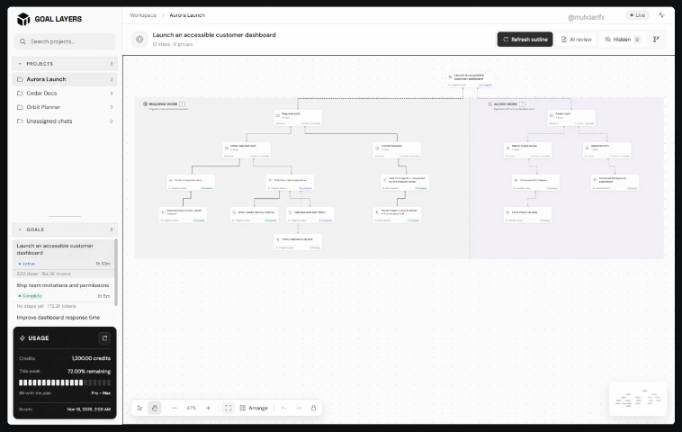

<p align="center">
  
</p>

# Goal Layers

**See what your Codex goals require, what happened, and what still needs evidence.**

Goal Layers is a local Rust application that turns saved Codex goals and chat activity into an interactive work tree. Follow required work, inspect additions, read source-linked evidence, and keep reported progress separate from verified results.

[Quick start](#quick-start) · [Workspace](#workspace) · [Data and privacy](#data-and-privacy) · [Licensing](#licensing) · [Development](#development)



*The preview uses fictional project data.*

## What you can do

- **Understand the scope.** Explore a goal, its required work, later human requests, and additions that need review.
- **Inspect the evidence.** Open source quotations, recorded checks, blockers, next steps, and available token traces.
- **Refresh the record.** Rebuild an outline from local history or request an optional AI review in a temporary Codex fork.
- **Work in context.** Read conversations, queue replies, and continue a selected topic in its original chat.
- **Organize the view.** Move nodes, arrange the canvas, save layouts, edit local steps, and hide or restore items without deleting source history.

Goal Layers helps you assess the record. A reported completion, a passing check, and a complete solution are different things.

## Quick start

### Requirements

- Windows for the primary desktop workflow. A complete desktop experience on other operating systems has not been validated.
- Codex installed and signed in, with compatible app-server interfaces.
- A current Rust toolchain and native build tools for a source build.
- A modern web browser.

From this repository:

```powershell
cargo build --release --locked
.\target\release\goal-layers.exe
```

On Windows, the executable opens your browser at **http://127.0.0.1:4317**. Keep the process running while you use the app. To leave the browser closed:

```powershell
.\target\release\goal-layers.exe --no-open
```

A second launch opens an existing Goal Layers instance when it recognizes one on the expected port. The executable embeds the web interface and reconstruction schema.

The default `data/` directory lives beside the executable. Run it from a writable location, or set a different data file under [Configuration](#configuration).

### Open your first goal

1. Select a project in the sidebar and choose a saved goal.
2. Select **Build flow** to extract its outline. If an initial AI review is needed, review the usage confirmation before starting it.
3. Open a node to inspect its status, evidence, connections, and response.
4. Use **Refresh** for newer local records or **Deep review** for a combined AI review.

Project matching uses recorded assignments and normalized project/worktree paths. Chats without a reliable project link remain unassigned.

## Workspace

### Canvas and node details

The hand tool pans the canvas; the pointer moves nodes and selects groups. Shift-click changes the selection. Pinch or use the zoom controls to zoom; ordinary scrolling pans. **Arrange** reapplies the layout while keeping the camera position. Undo and redo cover layout changes in the current session.

Node positions are saved per goal in browser storage. Moving a node changes its position, not its source relationships. Lock, fullscreen, and minimap controls help navigate larger trees.

Node details group information into **Overview**, **Evidence**, **Connections**, and **Response**, where available. Existing steps support local editing with raw Markdown and rendered previews. There is no manual Add Step workflow. A local completion needs evidence text, but entering that text does not verify its truth.

**Hide** removes selected nodes and their displayed connections from the view after confirmation. It preserves source history and overall goal progress; children are not automatically hidden. Restore items through **Hidden nodes**. The original goal and display-only groups cannot be bulk-hidden.

### Conversations and queued work

The conversation panel shows user and assistant messages, expandable long messages, earlier history, and a shortcut to the latest response. Its width is adjustable and saved across refreshes. Recorded agent activity is grouped separately from final responses; private reasoning is not displayed.

Replies, **Ask AI for status**, and **Continue this topic** queue messages in the original Codex chat. Failed replies preserve the draft and reuse the request identity on retry. The work queue shows available delivery state and progress; confirmed queued requests can be cancelled, while uncertain local records can be dismissed.

**Queue acceptance is not proof that a turn started.** Another Codex connection may own the writer, and cross-connection delivery is not reliably established. Open the original chat when work stays idle. Goal pause/resume and responses to questions or permissions work only where the active connection supports them.

Available model, effort, speed, account, and usage information comes from Codex. Missing values remain unavailable. Change model settings in Codex through the provided link.

## Reading progress and scope

| Signal | What it tells you |
| --- | --- |
| Goal status | The status saved in Codex, not proof that every acceptance check passed. |
| Step status | Progress reported in history, a structured reply, or a local edit. |
| Verification evidence | A recorded result matched to a check; later edits or failures may make it stale. |
| Unknown or needs review | The available record does not support a stronger conclusion. |
| Added work | An addition or review candidate, not automatically unauthorized drift. |

**Required work** includes the original request and identifiable human-requested changes. A new directory, prerequisite, or AI-authored step is not sufficient evidence of drift.

Token traces connect nodes with recorded source turns and available usage. Several nodes can share a turn, so their figures are not exclusive costs to add together. Missing usage stays unavailable; cached input and different accounting can affect totals. Goal Layers does not calculate a dollar cost.

## Local extraction and AI review

Local extraction reads accessible history without calling a model. It reuses unchanged cached contributions and processes changed records. The compact overview is limited to 32 reported steps, 16 changed directories, and 12 later requests, with omissions disclosed.

| Action | Result |
| --- | --- |
| **Build flow** | Extracts a local outline; an initial AI review requires usage confirmation. |
| **Refresh** | Reads newer records and updates matching evidence; unresolved statuses can lead to an optional status-only review. |
| **Deep review** | Requests scope detail, evidence-based statuses, and an Added Work summary together. |
| **Run fresh review** | Requests another review instead of reusing a saved result. |

Before a new fork review, the app shows the model and fastest available speed for the account. Reviews consume Codex allowance or credits; API-key use may incur charges. The exact cost is not known in advance. Cancelling the confirmation does not start the review.

A review uses a temporary read-only, network-restricted fork. Connected app and MCP tools are disabled, approvals are disabled, and inherited goal continuation is cleared. Those restrictions limit the review's tools; they do not mean model processing is offline.

The original chat receives no review message. Follow progress in **Response**, open the fork in Codex, or request **Stop**. Failed and stopped forks remain available for inspection. After a successful response is saved, validated, and applied, its owned fork is deleted; cleanup failures can be retried.

Pending requests are reused to limit duplicates. Completed results can be reused while saved goal, outline, evidence, and node state remain unchanged. Unobserved project-file changes do not automatically invalidate that cache.

Responses are validated before application. Invalid or stale replies cannot overwrite unrelated work. Structured status replies can update selected nodes' reported status, blockers, and next step; ordinary prose does not. These updates do not change native Codex goal status or independently prove completion.

## Data and privacy

**Local inspection stays local; optional AI work uses Codex.**

Goal Layers reads saved goal objectives and statuses, thread metadata, project/worktree paths, available conversation records, recorded activity and check results, and available token/account usage. Session content can include source snippets, commands, file paths, and other private project text.

| Data | Where it is used or stored |
| --- | --- |
| Codex goal and thread stores | Read through a read-only local adapter for catalog information. |
| Conversation history and evidence | Read for outlines, node details, traces, and review context. |
| `data/nodes.json` | Local steps, edits, and visibility state. |
| `data/flows.json` and related data files | Saved flows, snapshots, caches, review responses, and message receipts. |
| Browser storage | Sidebar preferences and per-goal canvas layouts. |

Local catalog reading and outline extraction do not call a model. Optional AI review submits context through Codex; chat actions submit the message you request. That processing can send session or project content to the provider configured in Codex and is subject to that environment's settings and terms. Goal Layers is therefore **not an offline-only workflow** when those features are used.

Local node edits do not directly rewrite Codex goal databases. Explicit chat actions can affect the original conversation. Temporary review chats have the lifecycle described above.

Protect the data directory as project-sensitive material. There is no recording privacy mode: use fictional or non-sensitive data for screenshots, demos, and recordings. Inspect staged files before publishing; ignore rules do not remove already tracked files or prevent force-add.

The HTTP service binds to `127.0.0.1` and checks Host/Origin headers. It is designed for local use. Public exposure through a tunnel or proxy needs a separate authentication and security design.

## Configuration

| Variable | Meaning |
| --- | --- |
| `GOAL_ATLAS_CODEX` | Codex executable path. Otherwise the app prefers a desktop-bundled executable, then `codex` on PATH. |
| `GOAL_ATLAS_DATA` | Full path to the nodes JSON **file**, not a directory. Related files are stored beside it. |
| `CODEX_HOME` | Codex data directory; defaults to the current user's `.codex` directory. |

The `GOAL_ATLAS_*` names remain for compatibility.

```powershell
$env:GOAL_ATLAS_DATA = Join-Path $env:LOCALAPPDATA 'GoalLayers\nodes.json'
.\target\release\goal-layers.exe
```

## Licensing

Goal Layers is **source-available**, not distributed under an unrestricted open-source license. Read [LICENSE](LICENSE) for the operative terms and the scope of rights each copyright holder grants.

| Use | Terms |
| --- | --- |
| Personal projects or independent learning | Free when the activity is not performed for an organization, client, or paid service. |
| Internal organizational evaluation | One 30-day evaluation per named legal entity, starting with its first organizational use, for supported evaluation purposes under LICENSE. No separate agreement is needed for covered code. |
| Ongoing organizational use | A separate written commercial agreement is required after evaluation, even if internal access is free. |
| Resale, paid access, or redistribution in a paid product | Requires an express commercial grant; an internal-use agreement alone does not allow it. |

An internship task, employer project, or internal hackathon is organizational use. A private learning project remains personal use merely because it runs on a work laptop, subject to the device owner's policies. Purpose determines the category, not the day of the week or ownership of the laptop.

**Commercial pricing is not published.** There is no preset price, royalty, revenue percentage, or billing period. Request terms from the [repository maintainer](https://github.com/muhdarifx). Donations do not purchase a license.

For an internal-use agreement, the customer is the named legal entity; affiliates and clients are not automatically included. A seat is one distinct developer authorized to use Codex with Goal Layers for that entity, counted once across devices and accounts. Shared accounts do not reduce the seat count. The agreement must record the entity, authorized seat count, price, billing period, and start/end dates.

An internal-use license does not permit redistribution, sublicensing, resale, or a hosted service for third parties. Free redistribution under the source-available grant has its own conditions in LICENSE.

Either party may end an ongoing internal-use agreement on 30 days' written notice unless that agreement expressly provides otherwise. Evaluation expires automatically after 30 days. Stop covered organizational use when permission ends; your own data remains yours. LICENSE states the separate consequences of a breach.

Codex compatibility is version-sensitive. The software is provided as is, without a warranty, service-level agreement, or commitment to restore compatibility by a deadline. Any paid support or compatibility commitment must be written into the commercial agreement.

### Contributions and ownership

Contributors keep their copyright. Before a new contribution is merged under the contributor terms in LICENSE, its author must expressly acknowledge those terms in writing, including permission for the maintainer to offer commercial licenses. Do not submit third-party code without the necessary rights and notices.

These terms do not retroactively grant rights over earlier contributions. Before offering a commercial build or evaluation of code covered by older terms, the maintainer must obtain the missing permission or exclude that code. Publication of this README or LICENSE is not evidence that this ownership review has been completed.

Bundled dependencies retain their own licenses. Markdown-it notices are in `web/vendor/`; DM Sans and Space Grotesk notices are in `web/fonts/`.

## Development

The Rust backend is in `src/`, the embedded interface in `web/`, and browser checks in `tests/`. Key modules cover history access, extraction, flow persistence, tracing, chat actions, fork reviews, and structured status validation. `src/reconstruction-schema.json` defines the embedded structured-flow response.

```powershell
cargo fmt --check
cargo test --locked
cargo build --release --locked
node tests/titles.cjs
node tests/scope-breakdown.cjs
```

Browser checks need Node.js, Playwright, and Chrome. Some require a running app; the synthetic scope-review check does not need a live chat. Environment-dependent Rust checks are ignored by default. Tests that send messages require a disposable demo chat through `GOAL_LAYERS_TEST_THREAD`; never point them at important work. The optional interaction runner uses `GOAL_LAYERS_TEST_PROJECT` and `GOAL_LAYERS_INTERACTION_RUNNER`.

A passing default suite does not establish that ignored integrations passed. Downloadable releases may lag behind the published source. Parallel coding agents, shared goal memory, vector context, and file-ownership coordination remain future work in the published version described here.

### Reporting API

Agents can submit a structured report using a real thread identifier from the local catalog:

```json
{"id":"R1","thread_id":"YOUR_THREAD_ID","parent_id":null,"title":"Implement the requested change","status":"in_progress","lane":"aligned","evidence":"Recorded change or check","next":"Run the acceptance check","revision":0}
```

```powershell
Get-Content -LiteralPath .\report.json -Raw | .\target\release\goal-layers.exe report
```

Read existing nodes before updating. Revisions must match and increment after a successful write. Parents must belong to the same chat; cycles and cross-goal parenting are rejected.

Read endpoints include `/api/catalog`, `/api/thread/{id}`, `/api/trace/{id}`, `/api/flow/{id}`, and `/api/account`. Mutation endpoints cover reports, local node edits and visibility, reconstruction, reviews, cancellation, and queued chat messages. See the handlers in `src/main.rs` for the complete routes and validation.

Mutations use JSON with `X-Goal-Atlas: 1`. That header is not authentication for public hosting. The API is not a versioned public contract.

## Troubleshooting

| Problem | Next check |
| --- | --- |
| Cannot connect to Codex | Confirm installation and sign-in; set `GOAL_ATLAS_CODEX` if needed. |
| Missing project or goal | Check the saved goal and project/worktree association; a chat title is not a goal. |
| Unknown step status | Read its evidence and acceptance criteria. Missing evidence does not prove failure. |
| Review failed or stalled | Open its fork in Codex. Stop a running review or run a fresh one after failure. |
| Review shows old information | Check whether the result was reused; request a fresh review if needed. |
| Queued work stays idle | Open the original chat and inspect its writer/connection state. |
| Data cannot be saved | Use a writable executable location or configure `GOAL_ATLAS_DATA`. |
| Port is occupied | Reuse the recognized instance or close the conflicting process. The default port is fixed. |
| A node disappeared | Check Hidden nodes and restore it. |

## Support the project

Star the repository, share feedback, or leave an optional tip.

- **X payments:** `@muhdarifx`
- **Bitcoin (BTC, Bitcoin network):** `bc1qrrmxu88sxqs49ruywwau2mzntguzqt5sr0aact`
- **Solana (SOL, Solana network):** `5cPtrBFFMArTMhQ5xWKHVSrdTnKmqPtZ4ij54XgSSRHN`

Support is voluntary and grants no additional license rights.